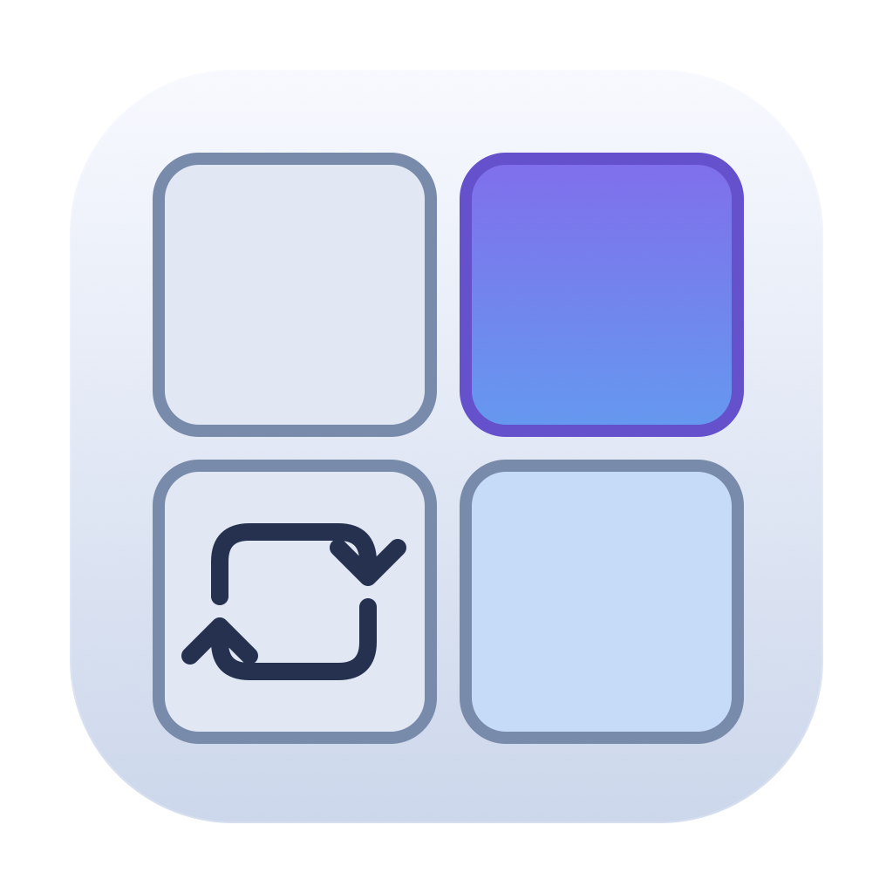
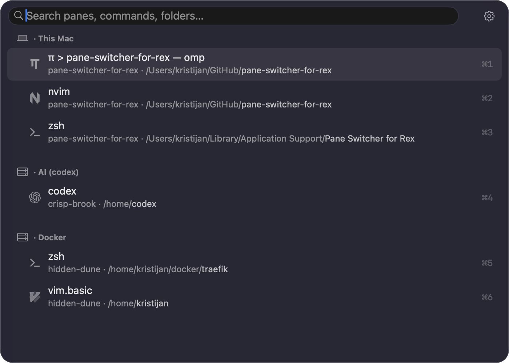

<h1 align="center">
    Pane Switcher for Rex
</h1>

<p align="center">
<picture>
  <source media="(prefers-color-scheme: dark)" srcset="docs/assets/app-icon-dark.png">
  
</picture>
</p>

<p align="center">
  A native macOS picker for switching between <a href="https://www.superlogical.com/rex">Rex</a> panes across local and remote hosts.
</p>

<p align="center">
  Search pane titles, commands, sessions, tabs, and working directories without leaving the keyboard.
</p>

<p align="center">
  
</p>

## Requirements

- **Apple Silicon Mac.**
- **macOS 15 Sequoia or later.**
- Rex installed and running, with its local server available.
- **Remote Control** enabled in **Rex Settings → Server → Remote Control**.

## Install

### Homebrew

```sh
brew tap kristijan/pane-switcher-for-rex
brew install --cask kristijan/pane-switcher-for-rex/pane-switcher-for-rex
```

To upgrade:

```sh
brew update
brew upgrade --cask kristijan/pane-switcher-for-rex/pane-switcher-for-rex
```

### Direct download

Download the Apple Silicon ZIP from [GitHub Releases](https://github.com/Kristijan/pane-switcher-for-rex/releases/latest), unzip it, and move **Pane Switcher for Rex.app** to **Applications**. Open it to begin setup.

## First launch

Open **Pane Switcher for Rex** from Applications. Setup lets you keep **Control-Command-P** or record your own shortcut, then checks that Rex is ready.

In Rex, enable **Settings → Server → Remote Control**. Setup cannot reliably verify this setting.

By default, the shortcut works while **Rex is frontmost**. Enable **Global shortcut** in Settings if you want to open the picker from any application. Selecting a pane brings Rex forward, while escape cancels and returns to the application you launched from.

The app lives in the menu bar. Reopen it from Finder or Spotlight to access Settings, even if you have hidden its menu-bar icon.

## Usage

| Key                                                                                  | Action                                                         |
| ------------------------------------------------------------------------------------ | -------------------------------------------------------------- |
| <kbd>⌃</kbd> <kbd>⌘</kbd> <kbd>P</kbd>                                               | Open the picker; configurable in Settings                      |
| <kbd>↑</kbd> / <kbd>↓</kbd> or <kbd>⌃</kbd> <kbd>K</kbd> / <kbd>⌃</kbd> <kbd>J</kbd> | Browse results, wrapping at either end                         |
| <kbd>↩</kbd>                                                                         | Switch to the selected pane                                    |
| <kbd>⎋</kbd>                                                                         | Close the picker                                               |
| <kbd>⌘</kbd> <kbd>1</kbd>…<kbd>9</kbd> / <kbd>⌘</kbd> <kbd>0</kbd>                   | Switch directly to one of the first ten filtered panes         |
| <kbd>⌘</kbd> <kbd>,</kbd>                                                            | Open Settings from the picker                                  |
| <kbd>⌃</kbd> <kbd>U</kbd>                                                            | Delete from the caret back to the beginning of the search line |
| <kbd>⌃</kbd> <kbd>W</kbd>                                                            | Delete the previous word                                       |

⌃ Control · ⌘ Command · ↩ Return · ⎋ Escape

Native macOS text editing, selection, undo, and redo work in the search field. Command-number jumps can be disabled in Settings.

### Search and filters

Search is case and diacritic insensitive. With an empty query, local panes appear before remote panes.

- `h:` or `host:` opens host suggestions. Type to narrow them, browse with Tab/Shift-Tab, arrows, or Control-J/K, then press Return to accept.
- `l:` or `local:` limits results to local panes.
- `r:` or `remote:` limits results to remote panes.
- Combine filters with text: `h:docker logs` or `r: vim`.
- Multiple host filters match **either** host: `host:Docker host:PiHole`.
- Quote names containing spaces: `host:"Build Mac"`.

The picker includes placed panes across sessions, tabs, and floating layers. It does not search terminal contents or panes nested inside tmux.

## Settings

Open Settings from the menu-bar menu, the picker's gear button, or by pressing <kbd>⌘</kbd> <kbd>,</kbd> while the picker is open.

- **Appearance:** Comfortable/Compact density, match colour, host/pane icons, working directories, recent-pane ordering, keyboard legend, jump labels, and menu-bar visibility. A live preview shows draft changes; Apply saves them.
- **Shortcuts:** record a shortcut and opt into global activation.
- **Advanced:** launch at login, custom Rex executable, optional debug diagnostics, and Revisit Setup to recheck Rex and your shortcut.

Updates are installed manually using the [Homebrew upgrade instructions](#homebrew) or a fresh download from [GitHub Releases](https://github.com/Kristijan/pane-switcher-for-rex/releases/latest).

Settings and recent-pane history are stored in `~/Library/Application Support/Pane Switcher for Rex/`.

## Limitations

- **Rex switching bubble:** switching panes can display a brief “rex: Go to Session” bubble. Rex generates this when the picker requests client-side session navigation; its current API exposes no supported option to suppress that bubble.
- **Picker-only recent history:** recent-pane ordering records successful selections made through this picker, not every pane focused in Rex. Rex exposes [per-session focus state and change events](https://www.superlogical.com/rex/docs/reference/events.md), but not a complete per-app foreground history across hosts. Those signals alone are insufficient to reliably identify the two most recently focused panes across all Rex navigation.
- **Remote Control must be enabled manually:** Rex's API does not expose a reliable, non-disruptive way to check whether Remote Control is enabled. Setup can verify connectivity, but that does not confirm permission to control the app. Enable **Remote Control** in **Rex Settings → Server → Remote Control**.

## Future Enhancements

Potential improvements, not currently available features or committed release plans:

- **Quick two-pane toggle:** press the launch shortcut again while the picker is open to return to the previous pane. A picker-selection-only version could use the app's own history; including all navigation outside the picker would require reliable per-app foreground tracking across hosts.
- **Silent switching:** remove Rex's switching bubble if Rex adds a supported way to suppress remote-action notices.

## Development

See [Contributing](CONTRIBUTING.md) for building from source, tests, and pull requests, and [Releasing](RELEASING.md) for signing, notarization, and the GitHub/Homebrew release workflow.
